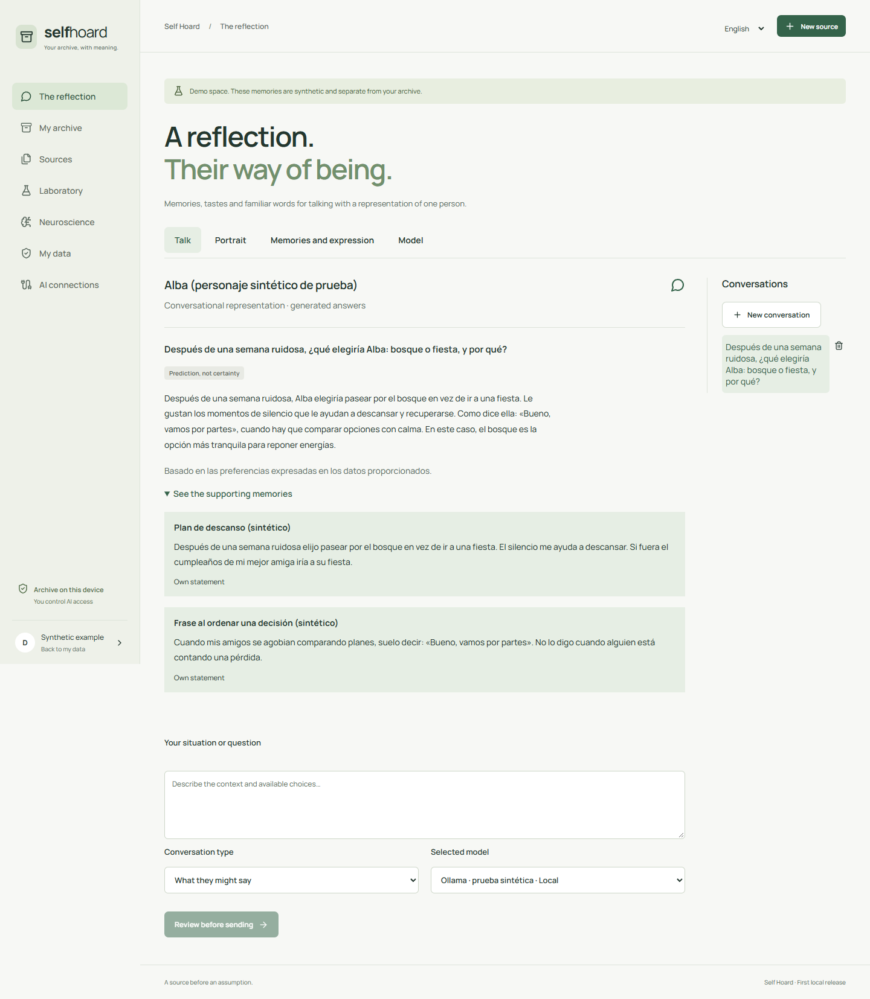

# Dorian's Hoard

Prototipo de investigación local que construye reflejos conversacionales de personas a partir de sus recuerdos, gustos, decisiones y formas de expresarse. La aplicación y sus iniciadores se llaman Self Hoard.

[Read in English](README.md)



*Aplicación real, persona ficticia y respuesta real de un modelo local. Muestra una integración, no la fidelidad a una personalidad.*

## Qué es

La idea es la continuidad personal: una familia podría algún día pedirle a un reflejo de su padre o madre una anécdota, un consejo o una opinión sobre algo nuevo. Para eso hay que conservar lo que le importaba, cómo sopesaba las alternativas, las excepciones a sus gustos y las frases que usaba con cada persona.

Self Hoard hace inspeccionables esos ingredientes. Un recuerdo conserva su fuente; una interpretación sigue siendo una interpretación; una muletilla conserva su contexto y frecuencia; una respuesta generada sigue siendo generada y nunca se incorpora sola a la biografía. Es un prototipo para un solo propietario en Windows y no pretende reproducir la conciencia ni un cerebro humano.

## Qué hace

**De la evidencia a la respuesta**
1. **Conservar las palabras.** Añade fuentes y fichas de recuerdo con extractos literales y atribución. Las afirmaciones del propietario, los recuerdos familiares y las interpretaciones de una IA siguen siendo distinguibles.
2. **Revisar a la persona representada.** Confirma recuerdos, criterios y ejemplos de expresión. Las muletillas, el humor, el ritmo y los gestos descritos pueden indicar relación, idioma, época, frecuencia, cuándo usarlos y cuándo evitarlos.
3. **Hacer una pregunta situada.** «¿Le gustaría esto?», «¿Qué opción elegiría?», «¿Cómo lo analizaría?» o «Cuéntame una anécdota».
4. **Inspeccionar la entrada exacta del modelo.** Antes de enviar se previsualizan la evidencia, las instrucciones, el destino y los límites configurados. La inferencia local es la opción por defecto.
5. **Leer una simulación atribuida.** Las respuestas conservan citas; las predicciones y análisis deben expresar incertidumbre. Retirar una evidencia invalida el contexto y el diálogo que dependen de ella.

**Áreas**

| Área | Qué ofrece | Límite |
| --- | --- | --- |
| Archivo personal | Fuentes en SQLite, citas literales, revisión, atribución, invalidación de dependencias, exportación JSON/Markdown | Recuperación léxica literal; la exportación del archivo no es una copia completa del reflejo |
| Reflejo | Retrato, fichas de recuerdo y de expresión, vista previa exacta de la entrada, conversación con citas, interfaz en español e inglés | Sin ajuste fino de un modelo personal, extracción de estilo de audio ni clonación de voz |
| Conexiones de modelo | Ollama, servidores locales compatibles con OpenAI, adaptadores OpenAI Responses y Anthropic Messages | Los adaptadores en la nube aún no se han verificado con credenciales |
| Interoperabilidad con IA | Herramientas MCP con lecturas acotadas, sondeo de cambios, bandeja de aportaciones atribuidas, caducidad y revocación | Las IA cliente no pueden aprobar evidencias ni concederse acceso |
| Laboratorio de decisiones | Editor bilingüe de ejemplos, revisión explícita, ajuste local de preferencias por pares, pruebas ciegas selladas, comparación de resultados | Valoraciones de rasgos aportadas por una persona; estimaciones sin calibrar; sin fidelidad de personalidad validada |
| Laboratorio visual | Escenarios de actividad, prioridades manuales, predicciones ocultas, comparaciones reveladas | Demostración con política manual, no un gemelo digital aprendido |

**Laboratorio de decisiones.** En **Laboratorio → Tus decisiones**, describe alternativas y valora criterios compartidos de 0 a 5, revisa tus ejemplos y ajusta un modelo local con al menos tres elecciones confirmadas del mismo ámbito (el modelo estadístico pequeño existente, en CPU, sin conexión a ningún LLM). Prepara una situación nueva, sella la predicción y la versión del modelo, registra tu propia elección y revela la comparación: acuerdo de elección y puntuación de Brier frente a una referencia uniforme, más una valoración de cuánto coinciden los motivos. Las etiquetas reservadas se excluyen de la recuperación conversacional. Las pruebas guardadas se pueden reabrir y descargar en JSON. La **Demostración manual** sigue disponible junto a este flujo, con filtros Todas/Pendientes/Respondidas e historial paginado (las predicciones pendientes siguen selladas). Una puntuación de Brier menor es mejor para ese caso; no establece calibración ni fidelidad a una persona.

La pregunta de investigación que hay detrás: ¿puede un reflejo conservar las decisiones, explicaciones y expresión de una persona haciendo inspeccionables su evidencia y su incertidumbre? Sonar familiar no prueba que se elija con acierto, y elegir bien no demuestra que el motivo declarado sea el de la persona. Las [notas de neurociencia](docs/Neurociencia_y_mundos_del_gemelo.md) examinan conectomas y simulación corporizada como inspiración para probar el comportamiento; la app no ejecuta esos simuladores.

## Cómo arrancarlo

Requisitos: Python 3.11+, Node.js 22 LTS con npm y Git. La primera ejecución descarga dependencias. Las conversaciones necesitan además una conexión a un modelo; los pesos no se incluyen.

```powershell
& '.\Iniciar Self Hoard.cmd'
```

El iniciador prepara Python, compila la interfaz si falta y abre **http://127.0.0.1:8741**. Elige English o Español en la cabecera. **Ejemplo sintético / Synthetic example** usa datos de demostración separados. Prepara un retrato y recuerdos revisados y configura **El reflejo → Modelo**. **Detener Self Hoard.cmd** detiene el servidor.

Tras actualizar el código, refresca dependencias y recompila antes de reiniciar:

```powershell
.\.venv\Scripts\python.exe -m pip install -r requirements-lock.txt
Push-Location frontend
npm.cmd ci
npm.cmd run build
Pop-Location
```

## Conectar otras IA y Faustus

Un cliente MCP puede leer el contexto permitido, comprobar cambios, aportar conocimiento atribuido a una bandeja o ejecutar una prueba de actividad permitida. La persona propietaria controla permisos, revisión, pausa, caducidad y revocación en **Conexiones de IA**; leer el reflejo requiere su propio permiso. La aplicación entrega la configuración del cliente; mantén su credencial en privado. La detección de cambios usa sondeo, no notificaciones push. Véase [configuración MCP, herramientas y límites de confianza](docs/MCP.md).

**Asistente de Faustus.** Con el lanzador compartido de Hoard Link instalado, la app muestra el panel de Faustus de la familia (un botón flotante). La conversación, el modelo y las herramientas viven en Faustus; esta app solo le dice al panel qué hay abierto.
- Contexto por vista: como la app no tiene rutas en la URL, publica la página, el espacio (la cabecera `X-Hoard-Space`), la afirmación, la fuente y la sección del reflejo abiertos. Los objetos guardados se referencian como `claim` (título resumido a 80 caracteres, estado, tipo, sujeto, id de fuente), `source`, `persona` (nombre, estado vital, consentimiento) y `conversation` (título, número de turnos), nunca con textos guardados completos, citas, claves de proveedor ni tokens de conexión.
- Los campos sin guardar se devuelven con el evento de ventana `dorian:context-request` desde los formularios `persona-form`, `claim-correction`, `claim-new`, `source-new`, `card-new` y `reflection-question`.
- Cuando el asistente termina un turno, el archivo se recarga en el sitio y los formularios abiertos y los resultados de búsqueda se quedan como están. El formulario del retrato envía solo los campos cambiados a `PATCH /api/reflection/persona`, que los fusiona en la misma transacción que lee el retrato guardado; el diálogo derivado se olvida solo si algo cambió de verdad.
- `create_app` instala el copiloto antes del comodín estático y `faustus-plugin.json` declara `x-family.copilot`. El relevo (`/api/copilot/proxy`) sigue la misma regla `X-Hoard-Request` que el resto de escrituras, y la política de seguridad de contenido no tiene `'unsafe-inline'`.

**Skills.** La app lleva `personal-context-consult` y `pretask-interview` de la biblioteca de skills de la familia para los agentes que se conectan, que se leen con `skills_list` y `skill_read` y se asignan en la página de skills (`/api/agent/skills/page`) o en la pestaña Skills del hub.

## Datos y límites de confianza

Los datos personales viven en el directorio `data/`, excluido de Git y separado de la demostración. No hay telemetría. Las peticiones al modelo envían el contexto aprobado al destino elegido; los clientes MCP externos tienen sus propios proveedores y retención. Los destinos locales son solo de bucle local, los remotos son fijos, y no hay reintentos automáticos, llamadas a herramientas ni proveedores de reserva.

Las claves de proveedores en la nube se protegen con DPAPI de Windows. **El archivo completo no está cifrado y la aplicación no autentica a distintos usuarios de la misma cuenta de Windows.** Las comprobaciones de origen locales no son un sandbox del sistema operativo. Revocar bloquea lecturas futuras; no puede borrar las copias que otro cliente ya conservó. Este prototipo es para uso local, no para alojamiento público multiusuario. Pendiente: acceso de lectores familiares, copias protegidas completas, recuperación semántica y evaluación longitudinal (véase el [plan de implementación](docs/IMPLEMENTATION_PLAN.md)).

## Estructura del proyecto

| Ruta | Contenido |
|---|---|
| `selfhoard/` | backend: `store.py`, `reflection.py` (ciclo de vida de la evidencia), `providers.py` (frontera con el modelo), `agents.py` y `mcp_server.py` (frontera con los agentes), `decisions.py` (evaluación), `lab.py`, `demo.py`, API FastAPI en `api.py` |
| `frontend/` | interfaz en React 19 y TypeScript con fuentes servidas en local |
| `docs/` | `ARCHITECTURE.md`, `REFLECTION.md`, `MCP.md`, `VALIDATION.md`, `IMPLEMENTATION_PLAN.md`, notas |
| `scripts/` | scripts auxiliares, incluida la comprobación opcional con un modelo real |
| `tests/` | pruebas de Python |
| `faustus-plugin.json` | manifiesto del plugin |
| `data/` | datos personales (no versionados) |

## Pruebas

```powershell
.\.venv\Scripts\python.exe -m pytest -q
.\.venv\Scripts\python.exe -m pip check
```

Las pruebas de navegador necesitan un servidor de pruebas aparte (`python -m selfhoard --port 8742 --data-dir <carpeta temporal>`) y Microsoft Edge, y después `npm.cmd run test:e2e` en `frontend`. Una comprobación opcional contra un modelo local real es `scripts/smoke_reflection_local.py --model <nombre>`. Estas pruebas verifican software e integraciones, no validez psicológica ni exactitud con personas reales; véase [docs/VALIDATION.md](docs/VALIDATION.md).

## Licencia

Aún no se ha elegido una licencia para el código original del proyecto; que el repositorio sea público no concede ninguna licencia. Las dependencias conservan sus respectivas licencias.
