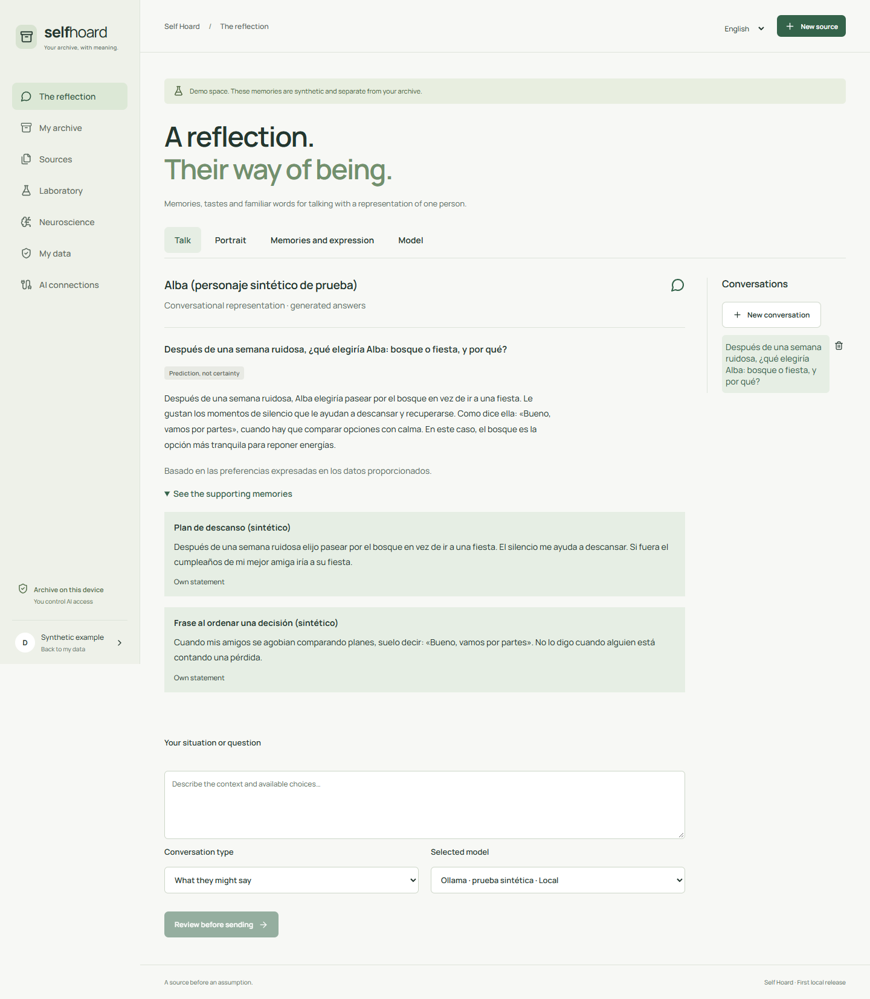

# Self Hoard

### ¿Qué diría? ¿Qué elegiría? ¿Por qué?

**Un prototipo de investigación local para construir reflejos conversacionales de personas a partir de recuerdos, gustos, decisiones y formas de expresarse.**

[English](README.md) · [Funcionamiento y límites](docs/REFLECTION.md) · [Conectar una IA](docs/MCP.md) · [Portfolio](https://luissalet.github.io/Portfolio/#projects)



*Aplicación real, persona sintética y respuesta real de Ollama. La interfaz admite español e inglés; las fuentes conservan su idioma. No es una medición de fidelidad personal.*

## Conservar una forma de ser

La idea es que una familia pueda algún día conversar con un reflejo de su padre o madre: pedir consejo, recordar una anécdota o imaginar su respuesta ante algo nuevo. Importan los valores, las preferencias, las excepciones, la forma de analizar y también las palabras familiares, las muletillas y el humor.

Self Hoard conserva esos elementos con fuentes y revisión. Un relato familiar mantiene su atribución. Una interpretación de IA no se convierte en palabras originales. Una respuesta generada no se incorpora automáticamente a la biografía.

Esta versión funciona como prototipo para un propietario en Windows. El acceso familiar, el cifrado integral y la validación longitudinal siguen pendientes. No reproduce un cerebro ni afirma conservar conciencia.

## Qué puedes hacer ahora

- Preparar un retrato y revisar recuerdos, criterios y ejemplos literales de expresión, con frecuencia, relación, idioma, época y situaciones en las que encajan o deben evitarse.
- Preguntar qué diría, qué le gustaría, qué elegiría o cómo analizaría una situación. Revisar los datos exactos y el destino antes de enviarlos.
- Consultar respuestas con citas e incertidumbre. Retirar evidencia e invalidar el contexto y diálogo dependientes.
- Conectar otras IA mediante diez herramientas MCP: permisos, consulta de novedades, aportaciones atribuidas a una bandeja, caducidad y revocación.
- Explorar actividades con una política manual. La API experimental añade preferencias aprendidas sobre episodios revisados y evaluación reservada; su interfaz está pendiente.

Ollama y servidores locales compatibles son opciones de inferencia. También existen adaptadores OpenAI y Anthropic, aún sin pruebas con credenciales reales. La recuperación usa coincidencias literales; no hay entrenamiento de un LLM personal ni clonación de voz.

## Para investigadores y equipos de ingeniería

**¿Puede un reflejo conservar decisiones, motivos y expresión sin perder la trazabilidad ni ocultar la incertidumbre?** Son objetivos distintos que necesitan evaluaciones separadas.

La API experimental sella una predicción antes de conocer la respuesta humana, excluye las etiquetas reservadas del contexto conversacional y calcula acuerdo y Brier frente a una referencia uniforme. Los motivos se valoran manualmente. Los siguientes pasos incluyen más baselines, evaluación humana de estilo y estudios longitudinales.

Las [notas de neurociencia](docs/Neurociencia_y_mundos_del_gemelo.md) investigan conectomas y simulaciones como FlyWire y NeuroMechFly como inspiración para evaluar comportamiento. Self Hoard no ejecuta esas simulaciones.

**Verificado el 12 de septiembre de 2026:** 61 pruebas Python, cinco recorridos Edge con procesos MCP reales, compilación y una prueba real Ollama con persona sintética, dos citas e incertidumbre. Son comprobaciones de software, no validación psicológica. [Registro de validación](docs/VALIDATION.md).

## Abrir en Windows

Necesitas Python 3.11+, Node.js 22 LTS con npm y Git. La primera instalación descarga dependencias; los modelos se configuran aparte.

```powershell
git clone https://github.com/Luissalet/SelfHoard.git
cd SelfHoard
& '.\Iniciar Self Hoard.cmd'
```

El iniciador prepara el entorno y abre **http://127.0.0.1:8741**. Elige el idioma y explora el ejemplo sintético separado de tu archivo. Configura **El reflejo → Retrato**, **Recuerdos y expresión** y **Modelo**. **Detener Self Hoard.cmd** detiene el servidor.

El [README en inglés](README.md#run-locally-on-windows) incluye actualización, arquitectura y comandos para reproducir las pruebas.

## Asistente de Faustus

Con el lanzador compartido de Hoard Link instalado, la app muestra el panel de Faustus de la familia (un botón flotante). La conversación, el modelo y las herramientas viven en Faustus; esta app solo le dice al panel qué hay abierto.

- **Contexto por vista.** La app no tiene rutas en la URL, así que publica la página, el espacio (la cabecera `X-Hoard-Space`), la afirmación, la fuente y la sección del reflejo abiertos. Los objetos guardados se referencian como `claim` (título resumido a 80 caracteres, estado, tipo, sujeto e id de fuente), `source` (título, tipo y referencias a todas sus afirmaciones), `persona` (nombre, estado vital, consentimiento) y `conversation` (título y número de turnos). Estas referencias no incluyen los textos completos guardados, la cita que respalda una afirmación, claves de proveedores ni tokens de conexión. Los formularios de creación no inventan objetos; sus campos pendientes se envían por separado.
- **Campos sin guardar.** El panel los pide con el evento de ventana `dorian:context-request`. Los formularios `persona-form`, `claim-correction`, `claim-new`, `source-new`, `card-new` y `reflection-question` responden con los valores completos de los campos que difieren de lo cargado. La página y el espacio capturados se conservan también cuando la sesión caduca y una petición necesita reintentarse después de cambiar de vista.
- **Refresco.** Cuando el asistente termina un turno, el archivo se recarga en el sitio (`hoard:copilot-turn-end` / `window.hoardCopilot.onTurnEnd`) y los formularios abiertos y los resultados de búsqueda se quedan como están.
- **Guardado.** El formulario del retrato envía solo los campos cambiados al nuevo `PATCH /api/reflection/persona`, que fusiona solo los campos presentes en el cuerpo dentro de la misma transacción que lee el retrato guardado. El diálogo derivado se olvida solo si algo cambió de verdad; los valores no válidos dejan el retrato intacto.
- **Montaje.** `create_app` llama a `install_copilot(app, 'dorian', data_dir)` antes del comodín estático, así que el lanzador se añade a la página de la app y `faustus-plugin.json` declara `x-family.copilot`. El script del lanzador se sirve sin sesión (la página lo pide antes de que exista la cookie); el relevo del panel (`/api/copilot/proxy`) sigue la misma regla de la cabecera `X-Hoard-Request` que el resto de escrituras (el lanzador compartido envía la cabecera), la lista de rutas públicas viene de la biblioteca compartida, y la política de seguridad de contenido no tiene `'unsafe-inline'` (el lanzador estiliza su panel con una hoja de estilos construida); `font-src` conserva `data:` solo porque la hoja de estilos propia de Dorian incrusta su fuente.
- **Pruebas.** `node --test frontend/copilot-context.test.mjs` y `python -m pytest tests/test_partial_updates.py`.

## Datos y estado del proyecto

Los datos se guardan en `data/`, excluido de Git. Las claves usan DPAPI de Windows; la base completa aún no está cifrada ni existe autenticación entre usuarios de la misma cuenta. Revocar una IA impide futuras consultas, pero no elimina copias ya guardadas por ese cliente. No hay telemetría; el contexto aprobado se envía al modelo elegido.

Las exportaciones del archivo no son una copia completa del reflejo. El [plan de implementación](docs/IMPLEMENTATION_PLAN.md) recoge lectores familiares, copias protegidas, recuperación semántica y evaluación longitudinal, entre otros pendientes.

Creado por [Luis Salete](https://github.com/Luissalet). Para colaborar en evaluación, preferencias, interacción persona-IA o legado digital, [abre una propuesta](https://github.com/Luissalet/SelfHoard/issues) con un caso sintético. No publiques biografías privadas ni credenciales.

## Licencia

La licencia del código original está pendiente de elección. La publicación del repositorio no añade una licencia de reutilización. Las dependencias conservan sus licencias.
