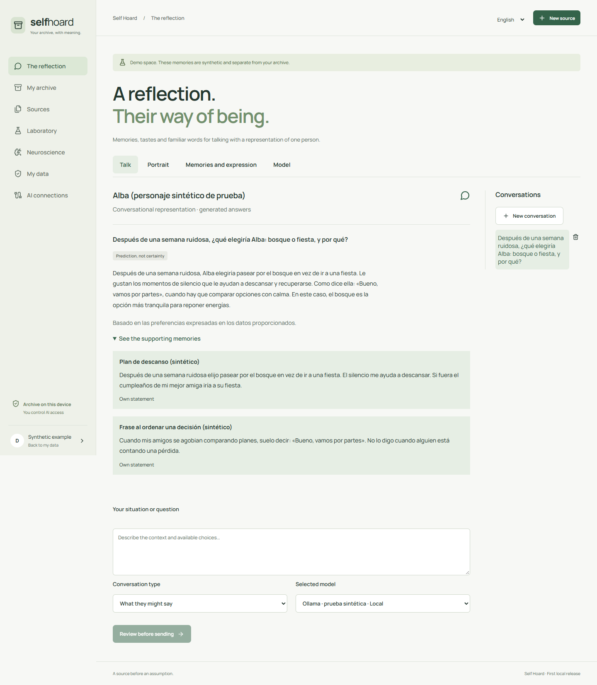

# Dorian's Hoard

A local-first research prototype that builds conversational reflections of people from their memories, preferences, decisions and ways of speaking. The application and its launchers are named Self Hoard.

[Leer en español](README.es.md)



*Actual application, fictional persona and a real local model response. This shows an integration, not personality accuracy.*

## What it is

The aim is personal continuity: a family might one day ask a reflection of a parent for an anecdote, advice or an opinion about a new situation. That requires preserving what mattered to them, how they weighed alternatives, exceptions to their preferences and the phrases they used with different people.

Self Hoard makes those ingredients inspectable. A memory keeps its source; an interpretation stays an interpretation; a catchphrase keeps its context and frequency; a generated answer remains a generated answer and is never added to the biography by itself. It is a single-owner Windows prototype and does not claim to reproduce consciousness or a human brain.

## What it does

**From evidence to answer**
1. **Preserve the words.** Add sources and memory cards with literal excerpts and attribution. Owner statements, family recollections and AI interpretations remain distinguishable.
2. **Review the person being represented.** Confirm memories, criteria and expression examples. Catchphrases, humor, rhythm and described gestures can specify relationship, language, period, frequency, when to use them and when to avoid them.
3. **Ask a situated question.** "Would they enjoy this?", "Which option would they choose?", "How would they analyse it?" or "Tell me an anecdote."
4. **Inspect the exact model input.** Evidence, instructions, destination and configured limits are previewed before sending. Local inference is the default.
5. **Read an attributed simulation.** Responses keep citations; predictions and analyses must express uncertainty. Withdrawing evidence invalidates the context and dialogue that depend on it.

**Areas**

| Area | What it offers | Boundary |
| --- | --- | --- |
| Personal archive | SQLite sources, literal quotes, review, attribution, dependency invalidation, JSON/Markdown export | Literal lexical retrieval; the archive export is not a complete reflection backup |
| Reflection | Portrait, memory and expression cards, exact input preview, cited conversation, Spanish/English interface | No personal model fine-tuning, audio style extraction or voice cloning |
| Model connections | Ollama, local OpenAI-compatible servers, OpenAI Responses and Anthropic Messages adapters | The cloud adapters have no credential-based verification yet |
| AI interoperability | MCP tools with scoped reads, change polling, an attributed update inbox, expiry and revocation | AI clients cannot approve evidence or grant themselves access |
| Decisions laboratory | Bilingual example editor, explicit review, local pairwise preference fitting, sealed blind trials, result comparison | Human-supplied feature ratings; uncalibrated estimates; no validated personality fidelity |
| Visual laboratory | Activity scenarios, manual priorities, hidden predictions, revealed comparisons | A manual-policy demonstration, not a learned digital twin |

**Decisions laboratory.** Under **Laboratory → Your decisions**, describe alternatives and rate shared criteria from 0 to 5, review your examples, then fit a local model from at least three confirmed choices in one domain (the existing small statistical model, on the CPU, with no LLM connection). Prepare a new situation, seal the prediction and the model version, record your own choice, then reveal the comparison: choice agreement and Brier score against a uniform reference, plus a rating of how well the reasons match. Held-out labels are excluded from conversational retrieval. Saved trials can be reopened and downloaded as JSON. **Manual demonstration** sits beside this workflow, with All/Pending/Answered filters and paged history (pending predictions stay sealed). A lower Brier score is better for that case; it does not establish calibration or fidelity to a person.

The research question behind it: can a reflection preserve a person's choices, explanations and expression while making its evidence and uncertainty inspectable? Sounding familiar is not evidence of choosing accurately, and choosing correctly does not show that a stated reason is the person's reason. The [neuroscience notes](docs/Neurociencia_y_mundos_del_gemelo.md) look at connectomes and embodied simulation as inspiration for testing behaviour; the app does not run those simulators.

## How to run it

Prerequisites: Python 3.11+, Node.js 22 LTS with npm, and Git. The first run downloads dependencies. Conversations also need a model connection; model weights are not bundled.

```powershell
& '.\Iniciar Self Hoard.cmd'
```

The launcher prepares Python, builds the interface when missing and opens **http://127.0.0.1:8741**. Choose English or Español in the header. **Synthetic example / Ejemplo sintético** uses separate demo data. Prepare a portrait and reviewed memories, then configure **The reflection → Model**. **Detener Self Hoard.cmd** stops the server.

After pulling an update, refresh dependencies and rebuild before restarting:

```powershell
.\.venv\Scripts\python.exe -m pip install -r requirements-lock.txt
Push-Location frontend
npm.cmd ci
npm.cmd run build
Pop-Location
```

## Connecting other AIs and Faustus

An MCP client can read permitted context, check for changes, contribute attributed knowledge to an inbox or run a permitted activity trial. The owner controls scopes, review, pause, expiry and revocation in **AI connections**; reading the reflection needs its own permission. The application provides the client configuration; keep its credential private. Change detection uses polling, not push. See [MCP setup, tools and trust boundaries](docs/MCP.md).

**Faustus assistant.** With the shared Hoard Link launcher installed, the app shows the family's Faustus panel (a floating button). The conversation, model and tools live in Faustus; this app only tells the panel what is open.
- Context per view: since the app has no URL routes, it publishes the open page, space (the `X-Hoard-Space` header), claim, source and reflection section. Saved objects are referenced as `claim` (80-character title preview, state, kind, subject, source id), `source`, `persona` (name, life status, consent) and `conversation` (title, number of turns), never with full saved texts, quotes, provider keys or connection tokens.
- Unsaved fields are returned on the `dorian:context-request` window event by the forms `persona-form`, `claim-correction`, `claim-new`, `source-new`, `card-new` and `reflection-question`.
- When the assistant finishes a turn the archive reloads in place and open forms and search results stay as they are. The portrait form sends only changed fields to `PATCH /api/reflection/persona`, which merges them in the same transaction that reads the stored portrait; derived dialogue is forgotten only when something actually changed.
- `create_app` installs the copilot before the static catch-all and `faustus-plugin.json` declares `x-family.copilot`. The relay (`/api/copilot/proxy`) follows the same `X-Hoard-Request` rule as every other write, and the content security policy has no `'unsafe-inline'`.

**Skills.** The app carries `personal-context-consult` and `pretask-interview` from the family's skill library for connecting agents, read with `skills_list` and `skill_read`, assigned on the skills page (`/api/agent/skills/page`) or in the hub's Skills tab.

## Data and trust boundaries

Personal data lives under the ignored `data/` directory, separate from the demo. There is no telemetry. Model requests send approved context to the selected destination; external MCP clients have their own providers and retention. Local destinations are loopback-only, remote endpoints are fixed, and there are no automatic retries, tool calls or fallback providers.

Windows DPAPI protects cloud-provider keys. **The full archive is not encrypted, and the application does not authenticate different users of the same Windows account.** Local origin checks are not an OS sandbox. Revocation blocks future reads; it cannot erase copies another client already retained. This prototype is intended for local use, not public multi-user hosting. Still to come: family reader access, complete protected backups, semantic retrieval and longitudinal evaluation (see the [implementation plan](docs/IMPLEMENTATION_PLAN.md)).

## Project layout

| Path | Contents |
|---|---|
| `selfhoard/` | backend: `store.py`, `reflection.py` (evidence lifecycle), `providers.py` (model boundary), `agents.py` and `mcp_server.py` (agent boundary), `decisions.py` (evaluation), `lab.py`, `demo.py`, FastAPI `api.py` |
| `frontend/` | React 19 and TypeScript interface with locally served fonts |
| `docs/` | `ARCHITECTURE.md`, `REFLECTION.md`, `MCP.md`, `VALIDATION.md`, `IMPLEMENTATION_PLAN.md`, notes |
| `scripts/` | helper scripts, including the opt-in real-model smoke check |
| `tests/` | Python tests |
| `faustus-plugin.json` | plugin manifest |
| `data/` | personal data (not tracked) |

## Tests

```powershell
.\.venv\Scripts\python.exe -m pytest -q
.\.venv\Scripts\python.exe -m pip check
```

Browser tests need a separate test server (`python -m selfhoard --port 8742 --data-dir <temporary folder>`) and Microsoft Edge, then `npm.cmd run test:e2e` in `frontend`. An opt-in check against a real local model is `scripts/smoke_reflection_local.py --model <name>`. These verify software and integrations, not psychological validity or accuracy on real people; see [docs/VALIDATION.md](docs/VALIDATION.md).

## Licence

A licence for the original project code has not been selected yet; public availability is not a licence grant. Dependencies retain their respective licences.
